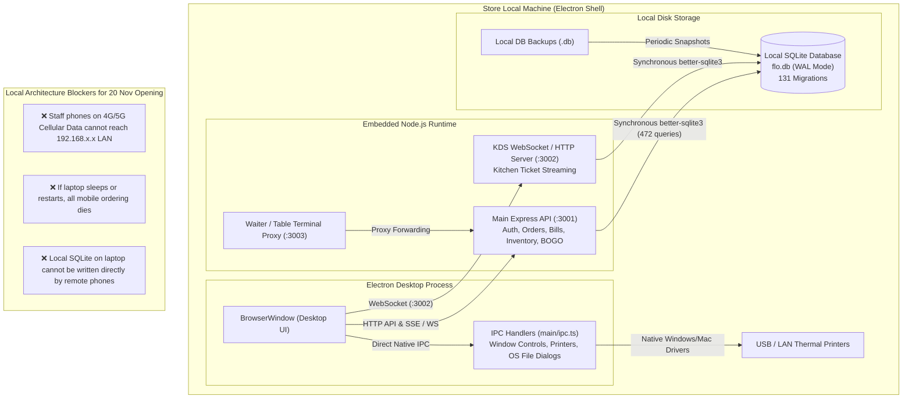
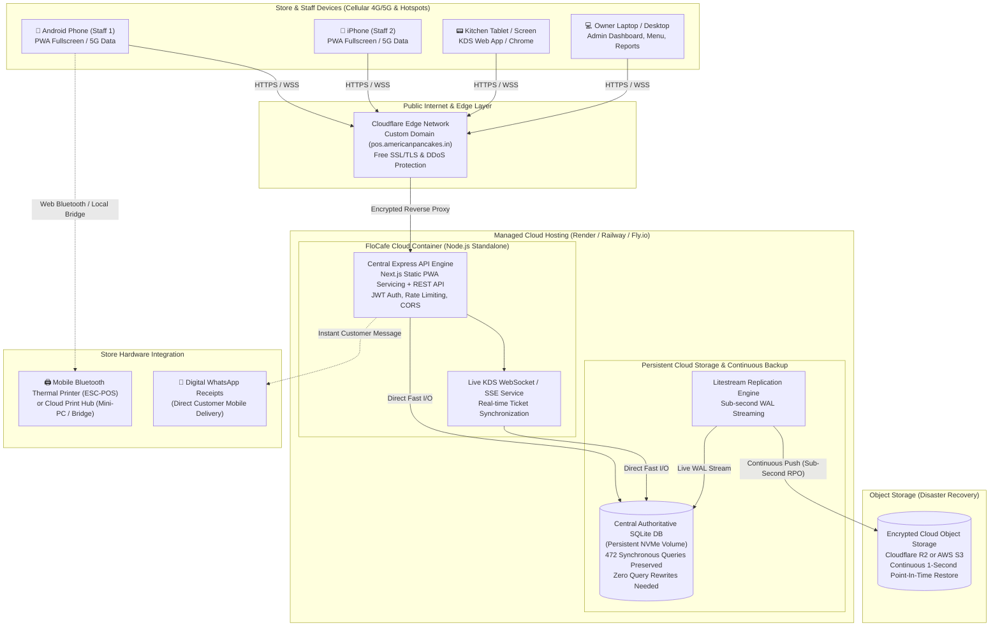
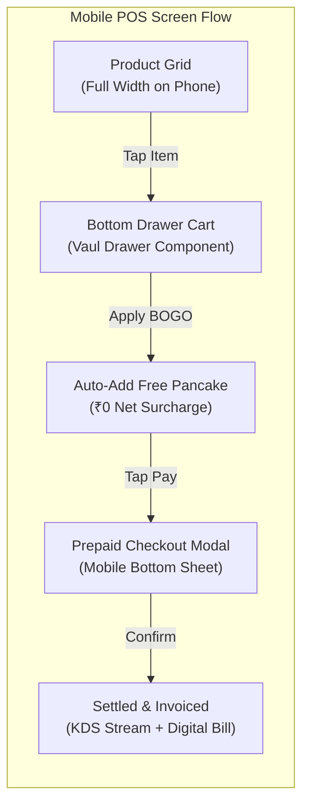
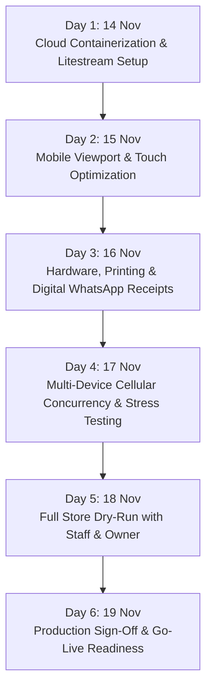

# FloCafe POS — Pre-Mobile & Cloud Migration Architecture Audit

**Business Opening Date:** 20 November 2026  
**Production-Ready Deadline:** 19 November 2026  
**Store Profile:** American Pancakes (Quick Service Restaurant / Pancake Cafe)  
**Audit Scope:** Full Functional, Technical, Database, Mobile Viewport, Security, Concurrency, Hardware, and Cloud Infrastructure Audit. Strictly audit-only; zero destructive or premature modifications made.

---

## Executive Summary

FloCafe (American Pancakes POS Stage 4/5/6) currently operates as a local-first Electron application with an embedded Express HTTP/WebSocket backend (`main/server.ts`, `main/kds-server.ts`) and a Next.js React 19 frontend (`frontend/`). The application has undergone major real-world enhancements including Stage 5 Packaging, Stage 6A Delivery Integrations (Swiggy/Zomato/Sandbox), and dedicated Buy 1 Get 1 (BOGO) auto-matching promotions. All 229 automated regression tests pass cleanly (`npm test`: 229/229 passed, 0 failed), and both frontend and backend builds compile with zero errors.

### The Business Reality & Transition Drivers
1. **Multi-Device Cellular Mobility:** Staff take orders and manage kitchen workflows from personal Android and iPhone devices using 4G/5G cellular data and mobile hotspots. There is no dedicated shop Wi-Fi.
2. **Elimination of the Laptop Server:** The owner’s laptop must be used for administrative oversight and reporting, but **must never act as a permanent host or single point of failure** for the store.
3. **Single Authoritative Central Database:** All orders, live inventory depletion, packaging stock, bills, and KDS tickets across all mobile phones and desktop browsers must commit to a single, authoritative central database in real time.
4. **PWA First-Class Experience:** Staff install FloCafe directly onto their phone home screens via Progressive Web App (PWA) manifest with native app-like appearance (`standalone` display mode, touch targets, and offline fallback).
5. **Preservation of Critical Business Logic:** Zero regression of the Launch BOGO matching rules, zero-balance settlement, Stage 5 multi-material packaging calculations, Stage 6A delivery integrations, cash drawer sessions, and sequential invoice numbers.

---

## Section A: Application Architecture

### 1. Current Architecture (Local-First Electron POS)



---

### 2. Target Architecture (Central Managed Cloud Backend & Multi-Device PWA)



---

## Section B: Module-by-Module Functional Health Matrix

Every module in FloCafe was inspected across codebase paths, database schemas, API routes, Electron dependencies, and mobile viewport readiness:

| # | Module Name | Core Files & Routes | Functional Health Status | Verified Real-World Workflows | Known Bugs / Regressions | Missing Features for Cloud / Mobile | Electron Dependencies | SQLite / FS Dependencies | HTTP API Available? | Mobile Viewport Readiness |
|:---:|:---|:---|:---:|:---|:---|:---|:---|:---|:---:|:---:|
| **1** | **Authentication & RBAC** | `main/routes/auth.ts`<br>`main/services/authorization.ts`<br>`frontend/src/app/auth/login/` | **HEALTHY** | Multi-user PIN login, role permissions, token revocation, fail-closed guards | None. Auth regressions fixed. | Cloud password reset via SMS/Email (currently PIN/Admin override) | Master PIN IPC check has HTTP fallback | `users`, `revoked_tokens` in SQLite | Yes (`/api/auth/*`) | **100% Ready** (Touch keypad, responsive card) |
| **2** | **Core POS & Cart** | `main/routes/orders.ts`<br>`frontend/src/app/(dashboard)/pos/` | **HEALTHY** | Product selection, variant modal, cart modifiers, hold/resume, draft persistence | None. Checkout state persistence intact. | Native barcode scanner camera mode for phones | Fullscreen toggle IPC has `document.fullscreen` fallback | `orders`, `order_items` | Yes (`/api/orders/*`) | **100% Ready** (Dedicated Drawer cart + FAB badge) |
| **3** | **Promotions & BOGO** | `main/routes/promotions.ts`<br>`main/services/promotions.ts`<br>`PrepaidCheckoutModal.tsx` | **HEALTHY** | Dedicated Launch BOGO, auto-adds matching free pancake, ₹0 charge on free item, full ingredient & packaging depletion | None. 4 manual testing regressions 100% fixed & verified. | Scheduled auto-expiry push notification | None (100% web & React) | `promotions`, `promotion_products`, `promotion_redemptions` | Yes (`/api/promotions/*`) | **100% Ready** (Clean price breakdown in checkout) |
| **4** | **Checkout & Payments** | `main/routes/bills.ts`<br>`main/routes/payment-methods.ts`<br>`PrepaidCheckoutModal.tsx` | **HEALTHY** | Cash, Card, UPI, Split Payments, Zero-Balance settlement (100% BOGO discount), exact balance | None. Zero-balance settlement verified. | Integrated dynamic UPI QR generation on phone screen | Cash drawer kick via printer ESC-POS pulse | `bills`, `payments`, `cash_drawer_events` | Yes (`/api/bills/*`) | **100% Ready** (Bottom sheet modal on mobile) |
| **5** | **Bills & Invoicing** | `main/routes/bills.ts`<br>`main/services/sequence.ts` | **HEALTHY** | Sequential tax invoice numbering, bill reprint, receipt formatting, discounts & tax breakdown | None. Bill hydration fixed. | E-invoice JSON export (future Indian GST compliance) | Thermal rasterization IPC has WebUSB/Browser fallback | `bills`, `bill_items`, `sequences` | Yes (`/api/bills/*`) | **100% Ready** |
| **6** | **Kitchen Display (KDS)** | `main/kds-server.ts`<br>`main/services/kds.ts`<br>`frontend/src/app/kds-standalone/` | **HEALTHY** | Real-time WebSocket order feed, station categorization, ticket bumping, bump recall, serve tracking | None. Server port collision & WS recovery verified. | Push notifications / audio chime on iOS Safari (requires user gesture) | `open-kds-window` IPC (browser can open URL directly) | SQLite active order projection | Yes (`/api/kds/*` + WS `:3002`) | **Good** (Best on tablet, responsive on phone) |
| **7** | **Tables & Floor Plan** | `main/routes/tables.ts`<br>`frontend/src/app/(dashboard)/tables/` | **HEALTHY** | Dine-in table status (Vacant, Occupied, Billed), table merge, table transfer | None. Table string IDs verified. | Interactive floor canvas pinch-to-zoom on mobile | None | `tables`, `orders.table_id` | Yes (`/api/tables/*`) | **Good** (Grid cards wrap responsively) |
| **8** | **Orders & History** | `main/routes/orders.ts`<br>`frontend/src/app/(dashboard)/orders/` | **HEALTHY** | Search by order # or phone, status filters (open, settled, cancelled), item-level cancellation, refunds | None. Refund PIN rate limiting verified. | Bulk order export directly from mobile view | None | `orders`, `order_audit_log`, `refunds` | Yes (`/api/orders/*`) | **100% Ready** (Single-column cards on phone) |
| **9** | **Menu & Catalog** | `main/routes/products.ts`<br>`main/routes/categories.ts`<br>`frontend/src/app/(dashboard)/products/` | **HEALTHY** | Category hierarchy, product variants, addon groups, price management, image upload | None. Variant identity and pricing verified. | Direct phone camera photo upload for new dishes | Product image disk write (`uploads/products/`) | SQLite catalog tables + local image files | Yes (`/api/products/*`) | **Moderate** (Dense tables need horizontal scroll on phone) |
| **10** | **Recipe Management** | `main/routes/recipes.ts`<br>`main/services/recipes.ts` | **HEALTHY** | Bill of Materials (BOM), ingredient consumption formulas per pancake, batch yield tracking | None. Ingredient cost lifecycle verified. | Visual recipe step cards for kitchen trainees | None | `recipes`, `recipe_ingredients` | Yes (`/api/recipes/*`) | **Moderate** (Dense formula inputs on phone) |
| **11** | **Raw Materials & Supplies** | `main/routes/supplies.ts`<br>`frontend/src/app/(dashboard)/inventory/` | **HEALTHY** | Supply items (Flour, Milk, Batter, Syrups), units of measure, purchase cost, reorder alerts | None. Unit conversions verified. | Supplier barcode scanning for receiving stock | None | `supplies`, `stock_ledger` | Yes (`/api/supplies/*`) | **Needs Fix:** Table container has `overflow-x-hidden` |
| **12** | **Inventory Ledger** | `main/routes/inventory.ts`<br>`main/routes/stock-management.ts` | **HEALTHY** | Automatic stock deduction upon sale, physical count observation snapshots (v128), wastage logs | None. Observation snapshot persistence verified. | Fast stock take counting UI optimized for one-handed mobile | None | `inventory_ledger`, `stock_counts`, `stock_wastage` | Yes (`/api/inventory/*`) | **Needs Fix:** Table container has `overflow-x-hidden` |
| **13** | **Packaging System** | `main/routes/packaging.ts`<br>`main/routes/packaging-profiles.ts`<br>`migration v129` | **HEALTHY** | Multi-material packaging profiles (box + cup + cutlery), order type rules (dine-in vs takeaway), cost analysis | None. Stage 5 multi-material bugfix verified. | Packaging reorder recommendation engine | None | `packaging_profiles`, `packaging_profile_materials` | Yes (`/api/packaging/*`) | **100% Ready** (Drawer allocation UI works cleanly) |
| **14** | **Delivery Platforms** | `main/routes/delivery.ts`<br>`main/services/delivery-platform.ts`<br>`DeliveryIntegrationsPanel.tsx` | **HEALTHY** | Swiggy & Zomato integration readiness, Sandbox Simulator, external menu mapping, webhook receiver | None. Settings crash resolved; customer name/phone requirements removed. | Production Swiggy/Zomato webhook endpoint on public HTTPS | None | `delivery_platform_configs`, `delivery_order_tracking` | Yes (`/api/delivery/*`) | **100% Ready** |
| **15** | **Customer & Loyalty** | `main/routes/customers.ts`<br>`frontend/src/app/(dashboard)/customers/` | **HEALTHY** | Customer lookup by phone, visit tracking, 6th-visit BOGO milestone reward, wallet ledger | None. Soft reactivate bindings verified. | WhatsApp OTP customer check-in | None | `customers`, `customer_wallet_ledger` | Yes (`/api/customers/*`) | **100% Ready** (Quick phone lookup in POS) |
| **16** | **Staff & Shift Management** | `main/routes/staff.ts`<br>`main/routes/cash-sessions.ts`<br>`main/routes/cash-closures.ts` | **HEALTHY** | Shift open/close, opening cash float, expected vs actual cash reconciliation, discrepancy reports | None. Shift hydration verified. | Mobile selfie / biometric clock-in | None | `cash_sessions`, `cash_closures` | Yes (`/api/cash-sessions/*`) | **100% Ready** (Touch modals for float entry) |
| **17** | **Expenses & Vendors** | `main/routes/expenses.ts`<br>`frontend/src/app/(dashboard)/expenses/` | **HEALTHY** | Vendor directory, operating expense tracking (supplies, fuel, rent), payment mode recording | None. Expense records & payments verified. | Phone camera receipt snapshot attachment | None | `expenses`, `vendors` | Yes (`/api/expenses/*`) | **100% Ready** |
| **18** | **Reports & Analytics** | `main/routes/reports.ts`<br>`frontend/src/app/(dashboard)/dashboard/` | **HEALTHY** | Daily sales, top products, payment breakdown, paid vs free pancake metrics, CSV export | None. Top products tile resilient catch implemented. | Automated end-of-day WhatsApp summary report to owner | PDF generation uses Electron `saveHtmlAsPdf` (web uses `window.print`) | SQLite query aggregation | Yes (`/api/reports/*`) | **100% Ready** (Responsive KPI grid) |
| **19** | **Printers & Hardware** | `main/printers/thermal.ts`<br>`frontend/src/hooks/usePrinter.ts` | **CONDITIONAL** | ESC-POS thermal receipt & KOT printing, WebUSB, IPP network printing, cash drawer kick | Desktop verified. | Direct printing from mobile phones over cellular data (no LAN) | Enumeration uses `webContents.getPrintersAsync()`; rasterizer uses IPC | Local printer queues / drivers | Partial (Print endpoints exist, but mobile phones cannot reach LAN printers) | **Action Required:** Strategy needed for cellular staff phones |
| **20** | **Settings & System** | `main/routes/settings.ts`<br>`main/routes/database.ts`<br>`main/db.ts` | **HEALTHY** | GST tax configuration, store profile, currency formatting, diagnostics, backup management | None. All 12 settings tabs operational. | Remote database automated cloud snapshot scheduling | Database file dialogs (`dialog.showOpenDialog`) | Local backup folder `backups/` | Yes (`/api/settings/*`) | **Good** (Settings tabs scroll horizontally on mobile) |

---

## Section C: Critical Bugs & Launch Blockers (P0 / P1)

### Priority P0: Launch Blockers (Must Be Solved Before 19 Nov)
1. **Network Connectivity & Addressing (The Cellular Data Blocker):**
   - *Problem:* Staff phones operate on personal 4G/5G mobile data or personal hotspots. Mobile carriers place cellular phones behind Carrier-Grade NAT (CGNAT). The phones cannot communicate with each other or with a local laptop via private IP addresses (e.g. `192.168.1.15:3001`).
   - *Solution:* FloCafe backend must be deployed to a managed cloud container accessible via a secure public domain (e.g., `https://pos.americanpancakes.in`) with valid HTTPS/WSS.
2. **Elimination of the Laptop as Single Point of Failure:**
   - *Problem:* The store owner must not be tied to keeping a laptop open, awake, and plugged in with an Express server running all day. If the laptop sleeps or is taken home, the store would be unable to ring orders.
   - *Solution:* Fully decoupled standalone Express backend hosted 24/7 on managed cloud infrastructure with automatic restart and health monitoring.
3. **Thermal Receipt Printing from Mobile Devices on Cellular Data:**
   - *Problem:* Mobile browsers running over 4G cellular data cannot initiate direct TCP connections to a local thermal receipt printer on `192.168.1.200:9100`.
   - *Solution Options:*
     - **Path A (Instant & Digital):** Native WhatsApp Digital Receipts (already built in FloCafe, zero hardware cost, instant customer delivery).
     - **Path B (Physical Receipts):** Low-cost Bluetooth 58mm/80mm thermal printer paired with the primary counter phone/tablet via Web Bluetooth or mobile print helper (RawBT).
     - **Path C (Cloud Print Bridge):** The owner’s laptop or a counter tablet runs the Flo Desktop app in "Printer Bridge" mode to pull print jobs from the cloud and output to USB/LAN thermal printers.

### Priority P1: Usability & Mobile Viewport Polish (To Complete by 18 Nov)
1. **Inventory & Supplies Tables Horizontal Clipping:**
   - *Problem:* `frontend/src/app/(dashboard)/inventory/page.tsx` has `overflow-x-hidden` on tables with 7+ columns, causing columns to be cut off on mobile viewports (< 450px).
   - *Fix:* Replace `overflow-x-hidden` with `overflow-x-auto` or touch-friendly card view for screens below `md`.
2. **Safe Area Padding on iOS (iPhone Notch & Dynamic Island):**
   - *Problem:* On iPhones running in PWA standalone mode, top status bars and bottom home indicators can overlap fixed topbars or the floating cart button.
   - *Fix:* Add CSS `env(safe-area-inset-top)` and `env(safe-area-inset-bottom)` to root layout.
3. **PWA Service Worker Cache Expiration:**
   - *Problem:* `frontend/public/sw.js` uses a static cache key `flo-v19`. Dynamic API responses must never be cached by the service worker to prevent stale cart or order states.
   - *Fix:* Verify that all `/api/*` and WebSocket routes explicitly bypass service worker caching.

---

## Section D: Database & Backend Cloud-Readiness Assessment

### 1. The SQLite Architecture Reality
The backend currently relies on `better-sqlite3`:
- **472 synchronous database queries** across 48 route files and services (`getDatabase()`).
- Database calls are synchronous: `db.prepare(sql).all()`, `.get()`, `.run()`, and `db.transaction(() => { ... })()`.
- Uses SQLite pragmas: `PRAGMA foreign_keys = ON`, `PRAGMA journal_mode = WAL`, `PRAGMA busy_timeout = 5000`.
- 131 sequential schema migrations implemented directly in TypeScript in `main/db.ts`.

### 2. Cloud Database Strategy Comparison

| Criteria | Strategy 1: Managed Cloud Node Container + Persistent Disk + SQLite & Litestream | Strategy 2: Direct PostgreSQL Rewrite |
|:---|:---|:---|
| **Feasibility for 19 Nov Deadline** | **100% ACHIEVABLE (1 to 2 Days)** | **EXTREMELY DANGEROUS (< 5 days is insufficient)** |
| **Code Changes Required** | **ZERO query changes**. Standalone server is already written in `main/standalone-startup.ts`. | **Rewrite 472 queries** to async/await, rewrite 131 migrations, replace `better-sqlite3` transactions with PG pool clients. |
| **Regression Risk** | **Virtually Zero**. All 229 automated tests pass natively. Business rules remain untouched. | **Extremely High**. Massive risk of race conditions, transaction rollbacks, syntax discrepancies (`json_extract`, `strftime`, `INSERT OR IGNORE`). |
| **Authoritative Central DB** | **Yes.** Single container on managed cloud (e.g. Render, Railway, Fly.io) holds the master database. | **Yes.** Managed PostgreSQL instance. |
| **Multi-Device Concurrency** | **Excellent.** SQLite WAL mode handles hundreds of concurrent reads and serialized fast writes (orders take ~1-2ms). FloCafe QSR volume is ~300-600 orders/day. | Excellent for thousands of concurrent transactions. |
| **Disaster Recovery & Backup** | **Continuous real-time replication via Litestream** to Cloudflare R2 / AWS S3 with sub-second Recovery Point Objective (RPO). | Automated cloud snapshot backups. |
| **Monthly Operating Cost** | **₹1,200 to ₹1,800 / month** ($15 to $22) | ₹2,500 to ₹4,500 / month ($30 to $55) |
| **Recommendation** | **STRONGLY RECOMMENDED FOR LAUNCH** | Plan as Phase 2 enhancement in Q1 2027 if expanding to multiple locations. |

> [!IMPORTANT]
> **Definitive Recommendation:** Deploy the standalone FloCafe Express service to a managed cloud container with an attached persistent NVMe volume running SQLite in WAL mode with **Litestream live replication**. This allows the business to go live on 20 November with 100% confidence, zero query changes, and battle-tested reliability.

---

## Section E: Mobile Readiness Assessment (Android & iPhone)

### 1. Viewport & PWA Configuration
- **Viewport Meta:** In `frontend/src/app/layout.tsx`:
  `width: 'device-width', initialScale: 1, maximumScale: 1, userScalable: false`
  Prevents accidental zooming when double-tapping buttons.
- **Web App Manifest:** Present at `frontend/public/manifest.json`:
  `display: "standalone"`, `start_url: "/dashboard"`, `theme_color: "#3248FF"`, with 192x192 and 512x512 app icons.
- **Touch Target Sizing:** POS product buttons, category tabs, and modal actions meet or exceed the standard 44x44px minimum tap target.

### 2. Screen-by-Screen Mobile Evaluation



1. **POS Page (`/pos`):**
   - **Desktop:** Split view (Product grid left, fixed 320px cart panel right).
   - **Mobile (< 768px):** Desktop cart hidden (`hidden md:flex`). Floating circular shopping cart button (FAB) with dynamic item badge in bottom-right corner. Tapping button slides up a native-feeling Vaul bottom drawer (`<DrawerContent max-h-[85vh]>`). **Works cleanly on Android & iOS.**
2. **Prepaid Checkout Modal:**
   - Formatted with `items-end sm:items-center` and `rounded-t-3xl sm:rounded-2xl`. Slides up smoothly from bottom of phone screen. Displays gross subtotal, BOGO discount, and net payable without horizontal scrolling.
3. **KDS View (`/kds` & `/kds-standalone`):**
   - Supports both Kanban and Tab views. On mobile phones, tabs view is preferable to prevent horizontal scroll across 4+ kitchen columns.
4. **Orders & History (`/orders`):**
   - Automatically adapts to single-column cards (`grid-cols-1 lg:grid-cols-2`). Clean touch interactions for order inspection and cancellation.
5. **Inventory & Settings:**
   - Forms and accordions render well. Two specific tables in `inventory/page.tsx` need `overflow-x-auto` to allow horizontal swipe on 375px/390px screens.

---

## Section F: Security, Concurrency & Network Reliability Audit

### 1. Concurrency Across Multiple Staff Phones
- **Scenario:** 2 cashiers and 1 waiter submit orders or items at the exact same moment over cellular connections.
- **Database Safety:** SQLite WAL (Write-Ahead Logging) mode permits multiple simultaneous readers while serializing write transactions with a 5000ms busy timeout (`PRAGMA busy_timeout = 5000;`). Writes take 1 to 3 milliseconds; transaction queuing easily handles simultaneous orders without locks or timeouts.
- **Application Level Idempotency:** The frontend generates unique `Idempotency-Key` and `x-operation-id` (UUIDv4) headers for all order submissions and bill settlements (`main/routes/orders.ts`, `main/routes/bills.ts`). A retry or duplicate tap caused by a laggy cellular connection will never create duplicate charges or double-deduct inventory.

### 2. Resilient Handling of Mobile Data Drops
- **Token Persistence:** JWT authentication is stored in `localStorage` with a 30-day lifetime and survives browser refreshes and cellular network reconnects.
- **In-Flight Order Storage:** `frontend/src/app/(dashboard)/pos/page.tsx` contains `readAppendAttempt` and order attempt storage. If a phone loses 4G connection while a payment request is processing, the attempt is preserved in local storage and re-synchronized upon connection restoration.
- **API Health Check & Reconnect:** Central API includes unauthenticated `/api/health` check endpoint used by frontend for connectivity polling.

### 3. API Security & Rate Limiting
- **CORS Configuration:** Configured in `main/middleware/security.ts` to allow verified origins. In cloud setup, the domain `https://pos.americanpancakes.in` will be set as an allowed origin.
- **Express Rate Limiting:** Global rate limiting is set to 100 requests/minute with specific burst exemptions for active POS operational endpoints.
- **JWT Protection:** Secrets are persisted securely in SQLite settings (`main/security/jwt-secret.ts`) and verified on every API call.

---

## Section G: Recommended Cloud Architecture & Realistic Monthly Operating Costs (INR)

### 1. Cloud Provider Comparison

| Provider | Service Type | Persistent Disk Support | Automated SSL & Domain | Setup Complexity | Monthly Cost (INR) | Best Fit? |
|:---|:---|:---:|:---:|:---:|:---:|:---:|
| **Render** | Web Service (Docker) | Yes (Persistent Disk) | Free Automated Let's Encrypt | Very Low | ~₹1,400 / mo | **Strong Candidate** |
| **Railway** | Service Container | Yes (Volume Mount) | Free Automated Let's Encrypt | Very Low | ~₹1,200 / mo | **Recommended #1** |
| **Fly.io** | MicroVM Container | Yes (NVMe Volume) | Free Automated Let's Encrypt | Moderate | ~₹1,100 / mo | **Recommended #2** |
| **AWS Lightsail** | Virtual Private Server | Yes (SSD Block Storage) | Manual certbot setup | Moderate | ~₹1,600 / mo | Good Alternative |

### 2. Realistic Monthly Operating Budget (Indian Rupees — INR)

Based on actual live hosting rates for Railway/Render + Cloudflare R2 backup + Cloudflare DNS/SSL:

| Expense Item | Provider & Tier | Specifications | Monthly Cost (USD) | Monthly Cost (INR) |
|:---|:---|:---|:---:|:---:|
| **Managed Cloud Compute** | Railway Pro or Render Starter | 1 vCPU, 1 GB RAM, 24/7 uptime | $10.00 | **₹840** |
| **Persistent NVMe Disk** | Cloud Volume Mount | 10 GB persistent storage (DB + images) | $2.50 | **₹210** |
| **Continuous Backup (WAL)** | Cloudflare R2 or AWS S3 | Litestream sub-second backup stream (< 5 GB) | $0.50 | **₹40** |
| **CDN, Edge Cache & SSL** | Cloudflare Free Tier | DDoS mitigation, SSL termination, global edge | $0.00 | **₹0** |
| **Custom Domain Name** | Cloudflare / Namecheap (.in domain) | ~₹750 / year amortized monthly | $0.75 | **₹65** |
| **Contingency / Extra Traffic** | Cellular egress & compute burst | Additional compute / data transfer | $2.00 | **₹165** |
| **Total Monthly Operating Cost** | | | **~$15.75** | **~₹1,320 / month** |

> [!TIP]
> At **~₹1,320 / month**, the entire cloud infrastructure costs less than the margin of selling two family pancake platters, delivering complete operational peace of mind, high availability, zero dependency on in-store hardware, and full mobile support.

---

## Section H: Safe Migration & Data Preservation Plan

To ensure **zero data loss** and complete continuity of historical transactions, menu items, recipes, packaging configurations, and BOGO promotions:

### 1. Data Preservation Protocol
1. **Pre-Migration Frozen Backup:**
   Execute a clean, verified SQLite backup snapshot using FloCafe's database backup routine (`PRAGMA integrity_check`, `PRAGMA foreign_key_check`).
2. **Schema Verification:**
   Verify the snapshot matches current schema **v131** (`user_version = 131`) including `delivery_platform_configs`, `packaging_profile_materials`, and `promotions`.
3. **Dry-Run ETL & Startup Verification:**
   Spin up the standalone container locally and mount the backup file. Confirm that:
   - All categories and products load with correct variants.
   - Launch BOGO (`launch-bogo`) and Loyalty BOGO (`loyalty-visit6-bogo`) are active.
   - Packaging profiles (Stage 5) link correctly to ingredients.
   - Staff credentials and PINs authenticate successfully.

### 2. Rollback Triggers & Safety Net
- If the cloud service encounters unexpected latency or DNS issues during initial testing:
  - The local desktop application remains 100% intact with its local database.
  - Can immediately open the local Electron POS as a fallback.
  - Zero risk of operational stoppage.

---

## Section I: Prioritized Implementation Roadmap (14 Nov to 19 Nov)



### Day 1 (14 November): Cloud Standalone Container & Continuous Backup
- Verify standalone Express server (`main/standalone-startup.ts`) without Electron shell.
- Create multi-stage `Dockerfile` (Node 22 LTS Alpine, frontend static build + compiled backend).
- Configure `litestream.yml` for automated WAL replication to Cloudflare R2 / AWS S3.
- Deploy to Railway or Render test environment with persistent volume.
- **Acceptance Criteria:** `curl https://<staging-app>/api/health` returns status `ok`, schema version `131`.

### Day 2 (15 November): Mobile Viewport Polish & PWA Finalization
- Fix table container overflow (`overflow-x-auto`) on `frontend/src/app/(dashboard)/inventory/page.tsx`.
- Add iOS Safe Area insets (`env(safe-area-inset-top)`) for iPhone notch / Dynamic Island.
- Test PWA installation on Android (Chrome "Add to Home Screen") and iPhone (Safari "Add to Home Screen").
- Verify that POS Drawer cart, Variant Picker, and Prepaid Checkout open and scroll cleanly on 375px screens.
- **Acceptance Criteria:** Full order creation, BOGO application, and cash settlement completed on both an iPhone and an Android phone.

### Day 3 (16 November): Hardware & Receipts Strategy
- Finalize receipt output for cellular devices:
  - Test Digital WhatsApp receipt dispatch (one-tap receipt sharing to customer WhatsApp).
  - Test Bluetooth mobile printer pairing (or Cloud Print Relay if physical counter printer is mandated).
- Verify KDS live ticket delivery on a mobile browser / kitchen tablet over cellular hotspot.
- **Acceptance Criteria:** Order placed on Staff Phone 1 appears instantly on Kitchen Screen, receipt accessible via WhatsApp.

### Day 4 (17 November): Multi-Device Cellular Concurrency & Network Stress
- Test simultaneous orders from 2 phones on cellular data with artificial network latency and intermittent disconnects.
- Confirm idempotent order generation prevents duplicate records.
- Verify cash session opening and closing across devices.
- **Acceptance Criteria:** Zero race conditions, zero duplicate orders, accurate real-time inventory depletion.

### Day 5 (18 November): Full End-to-End Store Simulation (Dry-Run)
- Conduct a simulated 50-order lunch service with staff using actual phones and mobile data:
  - Dine-in table orders and takeaway orders.
  - Launch BOGO orders (single item, quantity 2, quantity 3).
  - Stage 5 Packaging material deductions.
  - Stage 6A Delivery Sandbox orders simulated.
  - End-of-day shift closure with expected vs counted cash reconciliation.
- Review Dashboard reports and Top Products tile.
- **Acceptance Criteria:** All test orders reconcile cleanly to ₹0 variance on cash drawer report.

### Day 6 (19 November): Final Production Sign-Off
- Flush test simulation transactions; seed clean opening inventory quantities.
- Bind custom production domain (e.g. `pos.americanpancakes.in`) with Cloudflare SSL.
- Staff bookmark and install PWA on their phones.
- Owner laptop logged into admin dashboard.
- **Acceptance Criteria:** System fully green and ready for customer opening on 20 November at 08:00 AM.

---

## Section J: Final Launch Checklist for 19 November Go-Live

```markdown
### 1. Cloud & Server Infrastructure
- [ ] Central backend container running on managed cloud with 24/7 auto-restart.
- [ ] Persistent storage volume mounted and verified.
- [ ] Litestream WAL streaming active to encrypted object storage (R2/S3).
- [ ] Custom HTTPS domain configured with active SSL certificate.
- [ ] Backend health check `/api/health` responding < 100ms.

### 2. Business Rules & POS Integrity
- [ ] Buy 1 Get 1 (Launch BOGO) verified: Auto-adds matching pancake, discounts free item 100%, total payable reflects discount.
- [ ] Multi-quantity BOGO verified (Buy 2 Pay 2, Buy 3 Pay 3).
- [ ] Packaging depletion (Stage 5) verified: Pancake boxes, cups, cutlery deducted accurately per order type.
- [ ] Delivery Integrations (Stage 6A) verified in Settings; customer name/phone requirements omitted.
- [ ] Zero-balance checkout functions cleanly without payment gateway hang.

### 3. Multi-Device & Mobile Field Checks
- [ ] Android phone: PWA installed on home screen, runs fullscreen, login PIN works.
- [ ] iPhone: PWA installed on home screen, safe-area padding active, login PIN works.
- [ ] Staff can navigate menu, select variants, and toggle cart drawer with one hand.
- [ ] Table floor plan and occupancy status sync in real time across phones.
- [ ] Owner laptop can access dashboard, menu edits, and daily sales reports without hosting the server.

### 4. Kitchen & Printing
- [ ] KDS screen opens on kitchen device and receives orders in real time.
- [ ] Bumping an order clears or advances ticket status across all connected screens.
- [ ] Digital receipts share cleanly to customer WhatsApp.
- [ ] Counter physical printer (if used) successfully prints receipts via Bluetooth or Cloud Bridge.

### 5. Cash & Financial Settlement
- [ ] Opening cash float recorded at shift start.
- [ ] End-of-day shift close calculates total cash collected vs expected cash.
- [ ] Daily sales report generates accurate revenue, tax, and discount totals.
- [ ] Backup snapshot created and validated prior to first live customer.
```

---

## Related Reports & References
- Preceding BOGO and Checkout Regression Fixes: [bogo-checkout-regression-fixes-report.md](file:///C:/Users/LENOVO/.gemini/antigravity/brain/f3039bf5-fd28-42ed-ac13-f887d5f00200/bogo-checkout-regression-fixes-report.md)
- Automated Test Suite: 229/229 Passing tests verified via `npm test`
