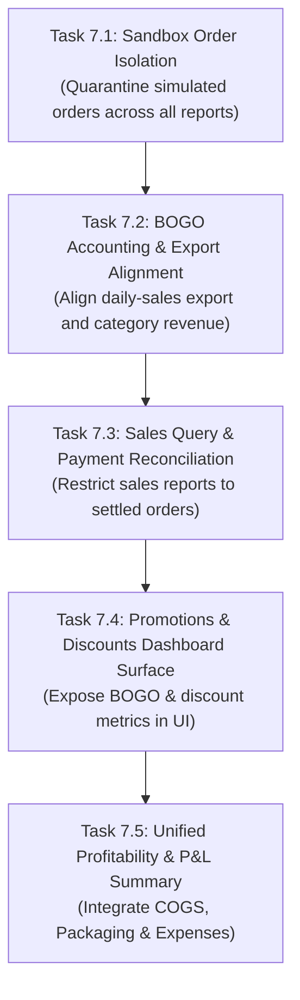

# FloCafe — Stage 7: Analytics & Reporting
## Phase 1: Read-Only Project Audit and Recovery of Original Requirements

**Audit Date:** 14 November 2026  
**Target Environment:** Local Dedicated Shop Laptop (Windows / Electron Desktop Application)  
**Audit Type:** Strictly Read-Only Architecture, Data Pipeline, Calculation, and Requirements Audit  
**Operating Status:** Stages 1–6 complete (131 database migrations, 229/229 regression tests passing). No source code or production databases modified.

---

## Executive Summary

This audit assesses the state of FloCafe’s analytics and reporting subsystems to recover the original Stage 7 requirements and identify all technical, financial, and architectural gaps prior to implementation. 

Stage 7 (Analytics & Reporting) was previously deferred while foundational QSR operations were completed (Stage 1 POS Foundation, Stage 2 Serving Allocations, Stage 3 Checkout Inventory Lifecycle, Stage 4 Suppliers & Stock Counts, Stage 5 Multi-Material Packaging, Stage 6A Delivery Integrations, and Stage 6 BOGO Promotions). 

While FloCafe possesses a rich reporting foundation—including daily sales XLSX/CSV/HTML exports, X/Z cash close reports, dashboard KPI cards, and receipt printing pipelines—our audit reveals **critical calculation and data-isolation discrepancies** that directly threaten business correctness:
1. **Delivery Platform Sandbox Pollution:** Test orders generated by the Stage 6A delivery sandbox simulator (`delivery_order_tracking.is_simulated = 1`) are currently aggregated into live store sales across `/api/reports/sales`, `/summary`, `/daily-stats`, `/financial-summary`, `/topProducts`, `/insights`, `/daily-sales/export`, and X/Z cash close reports.
2. **BOGO Free-Item Accounting in Exports & Categories:** While `GET /api/reports/topProducts` was recently patched to separate prepared, paid, and free quantities and subtract promotional discounts, `/insights` (`topCategories`) and `/api/reports/daily-sales/export` (`Items` sheet) still evaluate gross sales and net sales using `oi.subtotal` without subtracting free promotional discounts, causing free promotional pancakes to artificially inflate reported sales and appear twice.
3. **Unpaid & Pending Order Ingestion in Sales Reports:** `/api/reports/sales` (`dailySales` and `byOrderType`) queries `orders` based purely on `status != 'cancelled'`, which erroneously counts unpaid, held, or pending orders as earned revenue, breaking reconciliation with settled payment methods.

---

## A. Original Stage 7 Scope & Requirement Recovery

### 1. Repository Documentation & Historical Plan Recovery
An exhaustive search of the repository (`AMERICAN_PANCAKES.md`, `AMERICAN_PANCAKES_IMPLEMENTATION_PROGRESS.md`, `docs/reference/daily-sales-export.md`, `docs/reference/api.md`, `AGENTS.md`, and Git commit history) recovered the following original Stage 7 scope:

- **Origin & Purpose:**  
  In `AMERICAN_PANCAKES.md` Section 4, the roadmap established:
  - Stages 1–4: POS, inventory lifecycle, suppliers, purchases, stock counts, wastage.
  - Stage 5: Multi-material packaging profiles, allocations, and cost depletion.
  - Stage 6/6A: External delivery integration foundation, sandbox simulator, and flexible BOGO promotions.
  - **Stage 7 (Analytics & Reporting):** Unified owner and manager visibility into sales revenue, net collections, true product performance (paid vs. promotional), packaging and ingredient costs (COGS), operating expenses, staff performance, and tax liabilities across custom business-date ranges.
- **Foundational Architecture:**
  1. **Strict Separation of Paid vs. Promotional Quantities:** BOGO items (`product_name LIKE '%(BOGO Free)%'` or `modifier_selection.is_bogo_free = 1`) must be visible for kitchen prep and stock depletion, but **must never be counted as paid revenue**.
  2. **Delivery Sandbox Isolation:** Sandbox simulator orders (`is_simulated = 1`) are strictly for testing menu mapping and order lifecycles; they must be quarantined from actual financial reporting.
  3. **Direct Cost & Profitability Integration:** Sourcing frozen ingredient costs (`order_items.ingredient_cost`) and packaging costs (`order_item_packaging_allocations`) from Stage 3/5 immutable snapshots to compute Gross Contribution Margin without recalculating against present-day volatile supply prices.
  4. **Multi-Part Financial Reconciliation:** Net sales, bill collections, payment methods, cash drawer floats, refunds, and taxes must reconcile across all views (`Σ net_item_sales = Σ bills.subtotal = Σ payments - taxes - charges`).
  5. **CWE-1236 Compliant Exports:** Audit-ready XLSX, CSV, and HTML/PDF exports with formula injection protection.
  6. **Local Business Day Alignment:** Calculations must respect store-configured timezone (`Asia/Kolkata`) and custom business day start hour (e.g. 04:00 AM) rather than UTC date boundaries.

---

## B. Current Implementation Status

### 1. Functional Inventory Across Reporting Endpoints

| Endpoint / Component | Route / Service File | Purpose & Scope | Implemented Features | Gaps & Deficiencies |
|:---|:---|:---|:---|:---|
| **`GET /api/reports/daily-stats`** | `main/routes/reports.ts` (L211) | Real-time header metrics for today's shift. | Net sales, active order counts, table occupancy, table turn. | Does not exclude simulated delivery orders. Does not separate paid vs. promotional sales. |
| **`GET /api/reports/summary`** | `main/routes/reports.ts` (L294) | Day overview of orders, bills, and customers. | Order counts, bill collections, payment breakdown, customer count. | Includes simulated delivery orders. No discount or BOGO visibility. |
| **`GET /api/reports/financial-summary`** | `main/routes/reports.ts` (L374) | Detailed financial reconciliation & direct costs. | Gross collected, refunds issued, net collected, AOV, direct cost summary. | Includes simulated delivery orders. Refund query does not filter out cancelled bills. |
| **`GET /api/reports/sales`** | `main/routes/reports.ts` (L571) | Time-series sales and payment breakdown. | Grouped by business date, order type, and payment method. | **Critical:** Counts unpaid/open orders as sales. Includes simulated delivery orders. |
| **`GET /api/reports/topProducts`** | `main/routes/reports.ts` (L775) | Best-selling products by quantity & revenue. | Prepared, paid, and free quantities; gross sales; promo discounts; net revenue. | Includes simulated delivery orders. (BOGO separation is correct here). |
| **`GET /api/reports/insights`** | `main/routes/reports.ts` (L1022) | Operational intelligence & peak hours. | AOV, kitchen prep velocity, top staff, top categories, peak hours. | **Critical:** `topCategories` counts free BOGO items as paid revenue. Includes simulated delivery orders. |
| **`GET /api/reports/price-exceptions`** | `main/routes/reports.ts` (L516) | Audited manual price overrides. | Shift-filtered item overrides with reason and approver attribution. | None. Fully functional. |
| **`GET /api/reports/tax-components`** | `main/routes/reports.ts` (L466) | Tax breakdown (CGST, SGST, VAT). | Snapshot-derived per-component tax totals and shared-base flags. | Includes simulated delivery orders. |
| **`GET /api/reports/daily-sales/export`** | `main/services/daily-sales-export.ts` | Multi-sheet XLSX, CSV parts, and HTML. | 5 sheets (Summary, Daily, Taxes, Items, Payments), formula protection. | **Critical:** Free BOGO items inflate `gross_item_sales` and `net_item_sales`. Split products appear as separate rows. Includes sandbox orders. |
| **`GET /api/reports/customer-sales/export`** | `main/services/customer-sales-export.ts` | Customer itemized purchase history (PII). | Customer details, items, bill total on first row, CSV/XLSX. | Includes simulated delivery orders. |
| **`GET /api/promotions/reports/summary`** | `main/routes/promotions.ts` (L141) | Promotional discount & BOGO redemptions. | Redemption counts, total discounts, BOGO counts, Launch vs. Manual split. | **Correct:** Accurately excludes simulated delivery orders. Lacks front-end dashboard presentation. |
| **`GET /api/stock-management/dashboard`** | `main/routes/stock-management.ts` | Inventory health & purchase tracking. | Low/out-of-stock items, recent purchases, wastage, variance costs. | Disconnected from general sales reporting. |
| **`GET /api/expenses/summary`** | `main/routes/expenses.ts` | Operating expenditure tracking. | Incurred, paid, and due totals grouped by expense category. | Disconnected from revenue to compute true Operating Profit. |
| **`GET /api/packaging/dashboard`** | `main/routes/packaging.ts` | Packaging consumption & stock alerts. | Profile assignments, material consumption, low stock alerts. | Disconnected from main reporting dashboard. |
| **`Frontend Dashboard Page`** | `frontend/src/app/(dashboard)/dashboard/page.tsx` | Main UI surface for analytics & exports. | Responsive tiles, date pickers, profitability bar, export dropdown. | Missing dedicated Promotions tab and unified P&L view. |

---

## C. Reporting Correctness & Mathematical Verification

### 1. BOGO & Free-Item Reporting Verification
**Standard Test Scenario:**
A customer buys 1 Cotton Candy Pancake @ ₹90 and receives 1 matching Cotton Candy Pancake free via Launch BOGO.

#### Database Reality (`order_items`):
- **Row 1 (Paid):** `product_name: "Cotton Candy Pancake"`, `quantity: 1`, `unit_price: 90`, `subtotal: 90`, `discount_amount: 0`, `total: 90`.
- **Row 2 (Free):** `product_name: "Cotton Candy Pancake (BOGO Free)"`, `quantity: 1`, `unit_price: 90`, `subtotal: 90`, `discount_amount: 90`, `total: 0`.

#### Expected Business Reporting:
- **Quantity prepared:** 2
- **Paid quantity:** 1
- **Free quantity:** 1
- **Gross item value:** ₹180
- **Promotion discount:** ₹90
- **Net sales:** ₹90

#### Audit of Current Calculation Across Subsystems:
1. **`GET /api/reports/topProducts` (PASS):**
   ```sql
   total_quantity = SUM(oi.quantity) = 2
   paid_quantity  = SUM(CASE WHEN is_bogo_free ... THEN 0 ELSE oi.quantity END) = 1
   free_quantity  = SUM(CASE WHEN is_bogo_free ... THEN oi.quantity ELSE 0 END) = 1
   gross_sales    = SUM(oi.subtotal) = 180
   discount_amount= SUM(oi.discount_amount) = 90
   total_revenue  = SUM(oi.subtotal - oi.discount_amount) = 90
   ```
   *Result:* 100% Correct. Matches business requirement.

2. **`GET /api/reports/insights` -> `topCategories` (FAIL):**
   ```sql
   revenue = COALESCE(SUM(oi.subtotal), 0)
   ```
   *Result:* Evaluates to **₹180**. Does not subtract `oi.discount_amount`. **Free pancake is counted as ₹90 paid revenue!**

3. **`GET /api/reports/daily-sales/export` -> `Items` sheet (FAIL):**
   ```sql
   gross_item_sales = SUM(oi.subtotal + COALESCE(oi.discount_amount, 0))
   net_item_sales   = SUM(oi.subtotal)
   GROUP BY oi.product_id, oi.product_name, oi.product_sku
   ```
   *Result:*
   - For Paid Item: Gross = ₹90, Discount = ₹0, Net = ₹90.
   - For Free Item: Gross = 90 + 90 = **₹180**, Discount = ₹90, Net = **₹90**!
   - Total Gross reported for 1 pair = **₹270** (should be ₹180).
   - Total Net reported for 1 pair = **₹180** (should be ₹90).
   - Grouping fails: Displays two separate product rows (`Cotton Candy Pancake` and `Cotton Candy Pancake (BOGO Free)`).

### 2. Delivery Sandbox Isolation Verification
- **Requirement:** "Sandbox orders must not count as actual sales."
- **Audit Finding:**
  - `main/services/promotions.ts` (L1304) is the **only** service that excludes sandbox orders:
    `WHERE pr.order_id NOT IN (SELECT internal_order_id FROM delivery_order_tracking WHERE is_simulated = 1)`.
  - All standard reports (`/sales`, `/summary`, `/daily-stats`, `/financial-summary`, `/topProducts`, `/insights`, `/daily-sales/export`, and `cash-closures`) query `orders` and `bills` with `status != 'cancelled'`.
  - Because simulated delivery orders complete with `status = 'completed'` and `bills.payment_status = 'paid'`, **every simulated delivery order is currently counted as real in-store revenue and real cash/UPI collections.**

### 3. Revenue & Sales Reconciliation
- In `GET /api/reports/sales`:
  ```sql
  SELECT created_at, total FROM orders WHERE status != 'cancelled'
  ```
  This queries `orders.total` directly. If an order is in `pending` or `awaiting_payment` stage (unpaid), it is counted in `dailySales` and `byOrderType`. However, `byPaymentMethod` only counts paid bills.
  *Result:* Whenever uncompleted or held orders exist, `dailySales.total` does not equal `Σ paymentMethods.total`.

---

## D. Identified Issues & Risks

### Issue 1 (High Severity): Delivery Sandbox Orders Polluting Live Financials
- **Location:** `main/routes/reports.ts`, `main/services/daily-sales-export.ts`, `main/routes/cash-closures.ts`.
- **Root Cause:** Queries lack the predicate:
  `AND o.id NOT IN (SELECT internal_order_id FROM delivery_order_tracking WHERE is_simulated = 1)`.
- **Impact:** Testing delivery integrations corrupts real revenue, invoice counts, tax liability, and cash drawer reconciliations.

### Issue 2 (High Severity): Daily Sales Export & Category Insights Inflating BOGO Revenue
- **Location:** `main/services/daily-sales-export.ts` (L1297–L1310), `main/routes/reports.ts` (L1162).
- **Root Cause:** `daily-sales-export` was written under the legacy assumption that `oi.subtotal` is already net of discounts. Under Stage 6 BOGO, `oi.subtotal` stores the line gross value (₹90) and `oi.discount_amount` stores the 100% discount (₹90).
- **Impact:** Daily sales exports overstate gross sales by 150% and net sales by 200% for BOGO orders. Free items appear as distinct products rather than grouped with their parent pancake.

### Issue 3 (Medium Severity): `GET /api/reports/sales` Counting Unpaid Orders
- **Location:** `main/routes/reports.ts` (L589–L604).
- **Root Cause:** Queries `orders` where `status != 'cancelled'` instead of querying paid bills or requiring `orders.status IN ('completed', 'settled')`.
- **Impact:** Sales charts display inflated figures that diverge from cash closures and actual bank deposits.

### Issue 4 (Medium Severity): Disconnected Cost & Operational Reporting
- **Location:** `main/routes/stock-management.ts`, `main/routes/expenses.ts`, `main/routes/packaging.ts`.
- **Root Cause:** Supplier purchases, stock wastage, operating expenses, and packaging consumption live in separate dashboard endpoints without an integrated Profit & Loss summary.
- **Impact:** Owner must manually calculate net profitability by cross-referencing three separate application screens.

---

## E. Recommended Implementation Sequence (Prioritized Roadmap)

To ensure small, safe, independently testable increments without disturbing working functionality:



### Task 7.1: Delivery Sandbox Order Isolation (High Priority)
- **Goal:** Quarantine simulated delivery orders from all reporting and cash closure endpoints.
- **Scope:**
  - Create reusable SQL helper `EXCLUDE_SIMULATED_ORDERS_SQL`:
    `o.id NOT IN (SELECT internal_order_id FROM delivery_order_tracking WHERE is_simulated = 1)`.
  - Apply to `reports.ts` (`/daily-stats`, `/summary`, `/financial-summary`, `/sales`, `/topProducts`, `/recentOrders`, `/insights`, `/tax-components`), `daily-sales-export.ts`, and `cash-closures.ts`.
- **Test:** Run delivery simulator; verify reports remain unchanged.

### Task 7.2: BOGO Accounting & Daily Sales Export Alignment (High Priority)
- **Goal:** Reconcile `daily-sales-export.ts` and `topCategories` with Stage 6 BOGO rules.
- **Scope:**
  - In `daily-sales-export.ts`:
    - `gross_item_sales`: `oi.subtotal`.
    - `item_discounts`: `COALESCE(oi.discount_amount, 0)`.
    - `net_item_sales`: `oi.subtotal - COALESCE(oi.discount_amount, 0)`.
    - Normalize product name: Strip ` (BOGO Free)` suffix when grouping, so paid and free units aggregate into a single product line.
  - In `reports.ts` (`topCategories`): Subtract `oi.discount_amount` from revenue.
- **Test:** Verify 1 paid + 1 free pancake exports as Gross: ₹180, Discount: ₹90, Net: ₹90.

### Task 7.3: Sales Time-Series & Payment Reconciliation (Medium Priority)
- **Goal:** Ensure `GET /api/reports/sales` reflects settled revenue and reconciles with payment breakdowns.
- **Scope:**
  - Anchor `dailySales` and `byOrderType` to settled bills (`bills.paid_at IS NOT NULL`) rather than raw order creation.
  - Ensure cancelled-but-paid orders reflect net collections (gross minus refunds).
- **Test:** Create unpaid order; verify it does not appear in sales totals until settled.

### Task 7.4: Promotions & Discounts Reporting Surface (Medium Priority)
- **Goal:** Expose Stage 6 promotion metrics on the Dashboard UI.
- **Scope:**
  - Add a dedicated **Promotions & Discounts** card to `frontend/src/app/(dashboard)/dashboard/page.tsx`.
  - Consume `GET /api/promotions/reports/summary` to display Launch BOGO vs. Manual BOGO redemptions, total promotional discounts given, and percentage of sales discounted.

### Task 7.5: Consolidated Cost & P&L Reporting (Low Priority / Polish)
- **Goal:** Provide single-screen operational profitability.
- **Scope:**
  - Aggregate Net Revenue, Ingredient Costs, Packaging Costs, and Operating Expenses into an Operating Contribution summary over the selected date range.

---

## F. Verification & Regression Plan

### 1. Automated Tests Required
1. **`tests/stage7-reporting-correctness.test.ts` (New Suite):**
   - **BOGO Scenario:** 1 paid @ ₹90 + 1 free matching pancake.
     - Assert `topProducts`: prepared = 2, paid = 1, free = 1, gross = 180, discount = 90, net = 90.
     - Assert `topCategories`: revenue = 90.
     - Assert `daily-sales/export`: Items sheet shows 1 row with qty = 2, gross = 180, discount = 90, net = 90.
   - **Sandbox Isolation Scenario:**
     - Ingest 1 simulated Swiggy order @ ₹500 via sandbox simulator.
     - Assert `daily-stats`, `summary`, `financial-summary`, `sales`, and `daily-sales-export` report ₹0 sales.
   - **Unpaid Order Scenario:**
     - Create 1 unpaid order @ ₹200.
     - Assert `sales` daily sales and order type totals do not include ₹200 until settled.
2. **Regression Check:**
   - Execute full regression suite `npm test` (all 229 tests).
   - Execute `npm run test:discounts-promotions-stage6-bogo`.
   - Execute `npm run test:delivery-platform-stage6a`.
   - Execute `npm run test:daily-sales-export`.
   - Execute `npm run test:reports-export`.
   - Execute `npm run test:reports-insights`.

### 2. Manual Acceptance Scenarios
1. **Order Ringing & Report Check:**
   - Ring up 2 Nutella Pancakes with Launch BOGO applied. Total due = ₹180 (Customer receives 4 pancakes).
   - Check Dashboard: Top Products shows 4 prepared (2 paid + 2 free), Net = ₹180.
   - Export Daily Sales CSV: Items part shows Nutella Pancakes with Qty: 4, Gross: ₹360, Discount: ₹180, Net: ₹180.
2. **Sandbox Simulator Isolation:**
   - Trigger 2 sandbox orders in Settings → Delivery Platforms.
   - Verify that Dashboard Sales Today and Cash Close expected cash are completely unaffected.

---

## G. Final Assessment of Stage 7 Requirements

| Requirement Item | Status | Action Required |
|:---|:---:|:---|
| **Daily Sales Export (XLSX, CSV, HTML)** | **Partially Complete** | Fix BOGO `subtotal` / discount calculation and merge `(BOGO Free)` product grouping. |
| **BOGO Free-Item Revenue Separation** | **Partially Complete** | Complete in `topProducts`; must be applied to `topCategories` and `daily-sales-export`. |
| **Delivery Sandbox Order Exclusion** | **Not Implemented** | Must add simulation quarantine filter to all 9 reporting queries and cash closures. |
| **Settled Sales vs. Unpaid Order Reconciliation** | **Partially Complete** | Anchor `reports/sales` to settled bills instead of raw order records. |
| **Direct Costs (Ingredient + Packaging)** | **Complete** | `profitability.ts` correctly derives costs from immutable Stage 3 & Stage 5 snapshots. |
| **Audited Price Exceptions & Overrides** | **Complete** | `/price-exceptions` correctly records approver, old/new price, and reason. |
| **Tax Component Snapshot Reporting** | **Complete** | `/tax-components` and export `Taxes` sheet correctly break down CGST, SGST, VAT. |
| **Promotions & Discounts Dashboard View** | **Partially Complete** | Backend API exists (`/promotions/reports/summary`); front-end card is missing. |
| **Consolidated P&L (Sales - COGS - Expenses)** | **Not Implemented** | Optional enhancement; can be deferred to Stage 7 Phase 2. |

---

## Audit Completion Sign-Off
- **Report Location:** `docs/flocafe-stage-7-readiness-audit.md`
- **Source Code Status:** Unmodified.
- **Database Status:** Unmodified.
- **Ready for Implementation Approval:** Yes.
